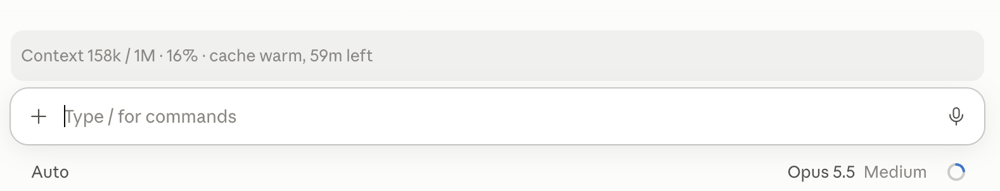

# context-meter

**Per-chat context and cache status for Claude Code**, in the terminal and the desktop app's Code tab. The account-wide usage meter tells you nothing about the chat you're in; this does:



Once the cache has expired:

```
Context 84k / 200k · 42% · cache cold: next message re-sends 84k uncached
```

A line above the prompt answers the question you have every time you open a chat: keep going here, or start fresh?

- **Context**: the tokens of this chat's last request against the model's window. Amber from 75%, red from 90%.
- **Cache**: whether the prompt cache from this chat's last turn is still alive, with a countdown. Once it's cold, your next message pays full price for the whole context again.
- **Resumed chats**: when each chat's last turn ended is remembered for 30 days, so a chat you come back to still knows whether its cache is warm.

It's a mod (a Claude Code plugin of function hooks): one small hooks module, no network, no dependencies.

## Install

In a terminal Claude Code session:

```
/plugin install context-meter --marketplace marinsokol5/claude-context-meter
```

Answer `y` to add the marketplace and pick the user scope. It then shows in every session, the desktop app's Code tab included.

## Settings

| Option | Default | |
| --- | --- | --- |
| `cacheTtl` | `1h` | How long the prompt cache lives after a response: `1h` on Claude subscriptions, `5m` by default on the API. Set it in `/config`. |

## How it works

- `session.measure` and `$.session.usage()` give the context fill, the same figures as the status line.
- `turn.complete` on the main thread marks when the cache was last refreshed (subagents keep caches of their own); the time is stored per session.
- The cache lifetime isn't exposed to plugins, so it comes from the `cacheTtl` option. The countdown is an estimate: the cache was refreshed by the turn's last request, a moment before the turn ended.

## Develop

```bash
claude plugin validate .
claude plugin test .
claude --plugin-dir .
```

## License

MIT
